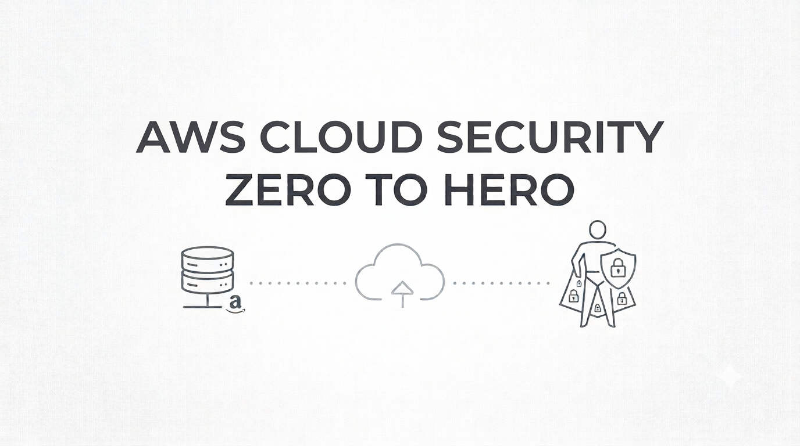

  

 

# AWS Cloud Security — Zero to Hero

### From cloud security fundamentals to advanced AWS security engineering — comprehensive explanations, security architecture diagrams, hands-on labs, and real-world projects.

---

## About This Repository

**AWS Cloud Security — Zero to Hero** is a structured learning repository designed to take you from understanding core cloud security principles to implementing secure, scalable, and resilient security architectures on Amazon Web Services (AWS).

The repository follows a progressive learning approach, beginning with security fundamentals and advancing through AWS security services, implementation techniques, hands-on labs, and real-world projects. The content is also aligned with the AWS Certified Security – Specialty (SCS-C03) certification objectives.

Each topic will include detailed explanations, architecture diagrams where useful, AWS service integrations, security best practices, and practical implementation guides.

By the end of this course, you will be able to:

- Understand cloud security fundamentals, threats, vulnerabilities, and risk management.
- Apply security principles such as least privilege, defense in depth, and Zero Trust.
- Implement identity and access management using AWS IAM, roles, policies, and federation.
- Secure AWS infrastructure using VPC security controls, network segmentation, and security services.
- Protect sensitive data using encryption, AWS KMS, and effective key management practices.
- Detect threats and monitor security events using Amazon GuardDuty, AWS CloudTrail, and AWS Security Hub.
- Investigate security incidents and implement incident response procedures.
- Apply AWS security governance, compliance, and security best practices.
- Build practical AWS security solutions through hands-on labs and real-world projects.
- Prepare for the AWS Certified Security – Specialty (SCS-C03) certification.

---

## 📚 Table of Contents

## 1. Cloud Security Fundamentals

This section introduces cloud security concepts, shared responsibility, security principles, threats, vulnerabilities, risk management, and cryptography.

📁 **[Explore → Cloud Security Fundamentals](./01-cloud-security-fundamentals/)**

| # | Sub-Topic | Description |
|---|-----------|-------------|
| 1.1 | [Cloud Security Fundamentals](./01-cloud-security-fundamentals/Cloud%20Security%20Fundamentals/) | Cloud security concepts, cloud service models, deployment models, shared responsibility model, and cloud security challenges |
| 1.2 | [Core Security Principles](./01-cloud-security-fundamentals/Core%20Security%20Principles/) | CIA triad, least privilege, defense in depth, Zero Trust, separation of duties, and security by design |
| 1.3 | [Threats, Vulnerabilities, and Risk](./01-cloud-security-fundamentals/Threats%20Vulnerabilities%20and%20Risk/) | Threats, attack vectors, vulnerabilities, misconfigurations, risk assessment, and mitigation strategies |
| 1.4 | [Cryptography Fundamentals](./01-cloud-security-fundamentals/Cryptography%20Fundamentals/) | Symmetric and asymmetric encryption, hashing, digital signatures, certificates, TLS, PKI, and key management |
| 1.5 | [Identity and Access Concepts](./01-cloud-security-fundamentals/Identity%20and%20Access%20Concepts/) | Authentication, authorization, MFA, federation, RBAC, ABAC, and privileged access |
| 1.6 | [Network Security Fundamentals](./01-cloud-security-fundamentals/Network%20Security%20Fundamentals/) | Network segmentation, firewalls, ingress and egress traffic, public and private networks, and access control |
| 1.7 | [Monitoring and Incident Response Concepts](./01-cloud-security-fundamentals/Monitoring%20and%20Incident%20Response%20Concepts/) | Logging, monitoring, alerting, incident triage, containment, eradication, recovery, and forensics |
| 1.8 | [Governance and Compliance Fundamentals](./01-cloud-security-fundamentals/Governance%20and%20Compliance%20Fundamentals/) | Security policies, standards, controls, risk management, audit evidence, compliance, and governance frameworks |

---

## 2. AWS Security Foundations

This section covers AWS security architecture, the AWS shared responsibility model, foundational security services, and account-level security.

📁 **[Explore → AWS Security Foundations](./02-aws-security-foundations/)**

| # | Sub-Topic | Description |
|---|-----------|-------------|
| 2.1 | [AWS Shared Responsibility Model](./02-aws-security-foundations/AWS%20Shared%20Responsibility%20Model/) | AWS responsibilities, customer responsibilities, and security responsibilities across AWS service models |
| 2.2 | [AWS Global Infrastructure Security](./02-aws-security-foundations/AWS%20Global%20Infrastructure%20Security/) | Regions, Availability Zones, edge locations, and infrastructure security considerations |
| 2.3 | [AWS Account Security](./02-aws-security-foundations/AWS%20Account%20Security/) | Root user protection, MFA, account contacts, security settings, and account isolation |
| 2.4 | [AWS Security Services Overview](./02-aws-security-foundations/AWS%20Security%20Services%20Overview/) | Overview of AWS security, identity, detection, monitoring, encryption, and compliance services |
| 2.5 | [AWS Organizations and Multi-Account Security](./02-aws-security-foundations/AWS%20Organizations%20and%20Multi-Account%20Security/) | Organizational units, multi-account architecture, centralized security, and account separation |

---

## 3. Threat Detection and Continuous Monitoring

This section covers AWS threat detection, security findings, centralized monitoring, log analysis, and alerting.

📁 **[Explore → Threat Detection and Continuous Monitoring](./03-threat-detection-and-monitoring/)**

| # | Sub-Topic | Description |
|---|-----------|-------------|
| 3.1 | [Amazon GuardDuty](./03-threat-detection-and-monitoring/Amazon%20GuardDuty/) | Threat detection, finding types, threat intelligence, malware protection, and delegated administration |
| 3.2 | [AWS Security Hub](./03-threat-detection-and-monitoring/AWS%20Security%20Hub/) | Centralized security findings, security standards, controls, and security posture management |
| 3.3 | [Amazon Inspector](./03-threat-detection-and-monitoring/Amazon%20Inspector/) | Vulnerability management for supported compute resources, container images, and code repositories |
| 3.4 | [Amazon Detective](./03-threat-detection-and-monitoring/Amazon%20Detective/) | Security investigation, finding relationships, and analysis of potentially suspicious activity |
| 3.5 | [AWS CloudTrail](./03-threat-detection-and-monitoring/AWS%20CloudTrail/) | API activity logging, event history, trails, management events, data events, and audit investigations |
| 3.6 | [Amazon CloudWatch](./03-threat-detection-and-monitoring/Amazon%20CloudWatch/) | Logs, metrics, alarms, dashboards, and security-related monitoring |
| 3.7 | [Amazon CloudWatch Logs Insights](./03-threat-detection-and-monitoring/CloudWatch%20Logs%20Insights/) | Querying and analyzing logs to investigate security events |
| 3.8 | [Amazon EventBridge](./03-threat-detection-and-monitoring/Amazon%20EventBridge/) | Event routing, security event processing, and integration with monitoring and response services |
| 3.9 | [AWS Config](./03-threat-detection-and-monitoring/AWS%20Config/) | Resource configuration history, configuration rules, compliance evaluations, and change tracking |

---

## 4. Incident Response

This section covers AWS incident response preparation, investigation, containment, recovery, and evidence preservation.

📁 **[Explore → Incident Response](./04-incident-response/)**

| # | Sub-Topic | Description |
|---|-----------|-------------|
| 4.1 | [Incident Response Fundamentals](./04-incident-response/Incident%20Response%20Fundamentals/) | Incident response lifecycle, preparation, identification, containment, eradication, recovery, and lessons learned |
| 4.2 | [AWS Incident Response Preparation](./04-incident-response/AWS%20Incident%20Response%20Preparation/) | Response plans, runbooks, security contacts, access preparation, and evidence collection readiness |
| 4.3 | [Compromised Credentials and Accounts](./04-incident-response/Compromised%20Credentials%20and%20Accounts/) | Investigating suspicious access, revoking credentials, reviewing sessions, and containing account compromise |
| 4.4 | [Compromised EC2 Instances](./04-incident-response/Compromised%20EC2%20Instances/) | Instance isolation, evidence preservation, snapshot handling, investigation, and recovery |
| 4.5 | [AWS Systems Manager for Incident Response](./04-incident-response/AWS%20Systems%20Manager/) | Session Manager, Run Command, inventory, and supported operational response workflows |
| 4.6 | [Incident Investigation and Evidence](./04-incident-response/Incident%20Investigation%20and%20Evidence/) | CloudTrail analysis, log preservation, timelines, forensic evidence, and chain of custody |
| 4.7 | [Automated Security Response](./04-incident-response/Automated%20Security%20Response/) | Event-driven response workflows, supported automated containment, and response validation |

---

## 5. Infrastructure Security

This section covers AWS network protection, compute security, edge protection, workload isolation, and secure infrastructure configuration.

📁 **[Explore → Infrastructure Security](./05-infrastructure-security/)**

| # | Sub-Topic | Description |
|---|-----------|-------------|
| 5.1 | [Amazon VPC Security](./05-infrastructure-security/Amazon%20VPC%20Security/) | VPC design, public and private subnets, route tables, security groups, and network isolation |
| 5.2 | [Network ACLs and Traffic Filtering](./05-infrastructure-security/Network%20ACLs%20and%20Traffic%20Filtering/) | Stateless network ACLs, inbound and outbound rules, ephemeral ports, and traffic filtering |
| 5.3 | [AWS Network Firewall](./05-infrastructure-security/AWS%20Network%20Firewall/) | Stateful and stateless rules, traffic inspection, firewall policies, and network protection |
| 5.4 | [AWS WAF](./05-infrastructure-security/AWS%20WAF/) | Web ACLs, managed rule groups, custom rules, rate-based rules, and web application protection |
| 5.5 | [AWS Shield](./05-infrastructure-security/AWS%20Shield/) | DDoS protection, Shield Standard, Shield Advanced, and integration with supported AWS services |
| 5.6 | [Amazon EC2 Security](./05-infrastructure-security/Amazon%20EC2%20Security/) | Instance hardening, metadata service security, security groups, Systems Manager access, and patching |
| 5.7 | [Elastic Load Balancing Security](./05-infrastructure-security/Elastic%20Load%20Balancing%20Security/) | Load balancer access controls, TLS listeners, certificates, and secure traffic distribution |
| 5.8 | [Amazon Route 53 Security](./05-infrastructure-security/Amazon%20Route%2053%20Security/) | DNS security, hosted zone access, DNSSEC, and domain protection |
| 5.9 | [Private Connectivity and VPC Endpoints](./05-infrastructure-security/Private%20Connectivity%20and%20VPC%20Endpoints/) | Gateway and interface endpoints, endpoint policies, private service access, and traffic isolation |
| 5.10 | [AWS Systems Manager and Patch Management](./05-infrastructure-security/AWS%20Systems%20Manager%20and%20Patch%20Management/) | Managed instance access, patch baselines, patch compliance, and secure administration |
| 5.11 | [Container and Serverless Security](./05-infrastructure-security/Container%20and%20Serverless%20Security/) | Amazon ECS, Amazon EKS, AWS Lambda, workload permissions, and service-specific security controls |

---

## 6. Identity and Access Management

This section covers AWS identity management, authorization, federation, privileged access, and permission governance.

📁 **[Explore → Identity and Access Management](./06-identity-and-access-management/)**

| # | Sub-Topic | Description |
|---|-----------|-------------|
| 6.1 | [AWS IAM Fundamentals](./06-identity-and-access-management/AWS%20IAM%20Fundamentals/) | IAM users, groups, roles, policies, permissions, and the policy evaluation process |
| 6.2 | [IAM Policies and Permissions](./06-identity-and-access-management/IAM%20Policies%20and%20Permissions/) | Identity-based and resource-based policies, permission boundaries, explicit deny, and least privilege |
| 6.3 | [IAM Roles and Temporary Credentials](./06-identity-and-access-management/IAM%20Roles%20and%20Temporary%20Credentials/) | Role assumption, AWS STS, temporary credentials, trust policies, and cross-account access |
| 6.4 | [IAM Identity Center and Federation](./06-identity-and-access-management/IAM%20Identity%20Center%20and%20Federation/) | Workforce access, SSO, identity providers, SAML, and supported federation patterns |
| 6.5 | [Multi-Factor Authentication](./06-identity-and-access-management/Multi-Factor%20Authentication/) | MFA methods, root user MFA, privileged access protection, and authentication best practices |
| 6.6 | [AWS Organizations and SCPs](./06-identity-and-access-management/AWS%20Organizations%20and%20SCPs/) | Service control policies, organizational guardrails, account restrictions, and permission boundaries |
| 6.7 | [IAM Access Analyzer](./06-identity-and-access-management/IAM%20Access%20Analyzer/) | External access findings, policy validation, unused access analysis, and policy generation |
| 6.8 | [Secrets and Credential Management](./06-identity-and-access-management/Secrets%20and%20Credential%20Management/) | AWS Secrets Manager, Systems Manager Parameter Store, credential rotation, and secret access control |
| 6.9 | [IAM Troubleshooting and Policy Evaluation](./06-identity-and-access-management/IAM%20Troubleshooting%20and%20Policy%20Evaluation/) | Policy simulation, access-denied analysis, permissions troubleshooting, and effective access evaluation |

---

## 7. Data Protection

This section covers encryption, key management, secrets, data security, certificate management, and protection of data at rest and in transit.

📁 **[Explore → Data Protection](./07-data-protection/)**

| # | Sub-Topic | Description |
|---|-----------|-------------|
| 7.1 | [AWS Key Management Service](./07-data-protection/AWS%20Key%20Management%20Service/) | KMS keys, key policies, grants, envelope encryption, rotation, and cross-account key access |
| 7.2 | [AWS CloudHSM](./07-data-protection/AWS%20CloudHSM/) | Hardware security modules, key custody, cryptographic operations, and integration considerations |
| 7.3 | [Encryption at Rest](./07-data-protection/Encryption%20at%20Rest/) | Encryption for Amazon S3, EBS, RDS, and other supported AWS storage services |
| 7.4 | [Encryption in Transit](./07-data-protection/Encryption%20in%20Transit/) | TLS, certificate validation, secure endpoints, and encrypted service communication |
| 7.5 | [Amazon S3 Security](./07-data-protection/Amazon%20S3%20Security/) | Block Public Access, bucket policies, access points, versioning, Object Lock, and encryption |
| 7.6 | [Database Security](./07-data-protection/Database%20Security/) | Encryption, authentication, network isolation, auditing, and access controls for AWS databases |
| 7.7 | [AWS Certificate Manager](./07-data-protection/AWS%20Certificate%20Manager/) | TLS certificates, certificate validation, renewal, and integration with supported AWS services |
| 7.8 | [AWS Secrets Manager](./07-data-protection/AWS%20Secrets%20Manager/) | Secret storage, rotation, resource policies, encryption, and application access |
| 7.9 | [Data Classification and Discovery](./07-data-protection/Data%20Classification%20and%20Discovery/) | Amazon Macie, sensitive data discovery, findings, and data protection workflows |
| 7.10 | [Backup, Retention, and Recovery](./07-data-protection/Backup%20Retention%20and%20Recovery/) | AWS Backup, retention policies, recovery objectives, and protection against accidental deletion |

---

## 8. Security Foundations and Governance

This section covers AWS security governance, compliance, risk management, security standards, and multi-account security operations.

📁 **[Explore → Security Foundations and Governance](./08-security-foundations-and-governance/)**

| # | Sub-Topic | Description |
|---|-----------|-------------|
| 8.1 | [AWS Security Best Practices](./08-security-foundations-and-governance/AWS%20Security%20Best%20Practices/) | Security baselines, least privilege, secure configurations, and AWS security guidance |
| 8.2 | [AWS Well-Architected Security Pillar](./08-security-foundations-and-governance/AWS%20Well-Architected%20Security%20Pillar/) | Security design principles, workload protection, detection, infrastructure protection, and incident response |
| 8.3 | [AWS Artifact and Compliance](./08-security-foundations-and-governance/AWS%20Artifact%20and%20Compliance/) | Compliance reports, agreements, audit evidence, and AWS compliance resources |
| 8.4 | [AWS Audit Manager](./08-security-foundations-and-governance/AWS%20Audit%20Manager/) | Evidence collection, assessment frameworks, control mapping, and audit preparation |
| 8.5 | [AWS Control Tower](./08-security-foundations-and-governance/AWS%20Control%20Tower/) | Landing zones, account governance, guardrails, and centralized multi-account management |
| 8.6 | [AWS Config Compliance](./08-security-foundations-and-governance/AWS%20Config%20Compliance/) | Configuration compliance, managed and custom rules, remediation options, and reporting |
| 8.7 | [Security Policies and Risk Management](./08-security-foundations-and-governance/Security%20Policies%20and%20Risk%20Management/) | Risk assessment, policy management, security controls, audit readiness, and compliance responsibilities |
| 8.8 | [Centralized Security Operations](./08-security-foundations-and-governance/Centralized%20Security%20Operations/) | Delegated administration, organization-wide findings, centralized logging, and cross-account security visibility |

---

## 9. Advanced AWS Security Architectures and Projects

This section applies AWS security services and best practices to realistic architectures and practical security scenarios.

📁 **[Explore → Advanced AWS Security Architectures and Projects](./09-advanced-aws-security-architectures-and-projects/)**

| # | Sub-Topic | Description |
|---|-----------|-------------|
| 9.1 | [Secure Multi-Account AWS Architecture](./09-advanced-aws-security-architectures-and-projects/Secure%20Multi-Account%20AWS%20Architecture/) | Design centralized security, account separation, organizational guardrails, and delegated administration |
| 9.2 | [Centralized Logging and Threat Detection](./09-advanced-aws-security-architectures-and-projects/Centralized%20Logging%20and%20Threat%20Detection/) | Collect and analyze security logs across accounts and integrate supported detection services |
| 9.3 | [Secure Three-Tier Web Application](./09-advanced-aws-security-architectures-and-projects/Secure%20Three-Tier%20Web%20Application/) | Secure VPC design, load balancers, private compute, database isolation, IAM, and encryption |
| 9.4 | [AWS Incident Response Simulation](./09-advanced-aws-security-architectures-and-projects/AWS%20Incident%20Response%20Simulation/) | Investigate simulated suspicious activity, analyze logs, contain affected resources, and document recovery |
| 9.5 | [S3 Data Protection Architecture](./09-advanced-aws-security-architectures-and-projects/S3%20Data%20Protection%20Architecture/) | Secure storage, encryption, access restrictions, data discovery, and recovery controls |
| 9.6 | [Cross-Account IAM Security](./09-advanced-aws-security-architectures-and-projects/Cross-Account%20IAM%20Security/) | Implement role-based cross-account access, trust policies, and least-privilege permissions |
| 9.7 | [AWS Security Posture Assessment](./09-advanced-aws-security-architectures-and-projects/AWS%20Security%20Posture%20Assessment/) | Evaluate security findings, configuration compliance, identity exposure, and remediation priorities |

---

## Official References

- [AWS Certified Security – Specialty (SCS-C03) Exam Guide](https://docs.aws.amazon.com/aws-certification/latest/security-specialty-03.html)
- [AWS Security Documentation](https://docs.aws.amazon.com/security/)
- [AWS Well-Architected Framework — Security Pillar](https://docs.aws.amazon.com/wellarchitected/latest/security-pillar/welcome.html)
- [AWS Skill Builder](https://skillbuilder.aws/)

``

